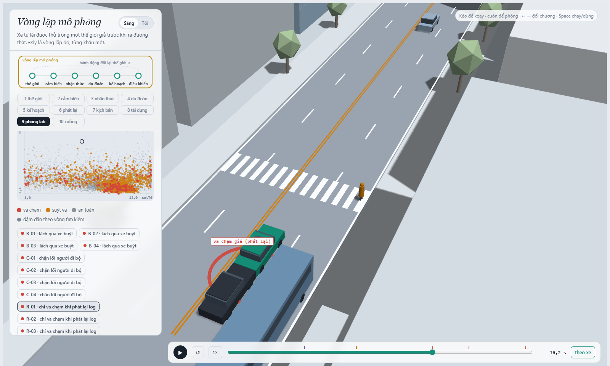
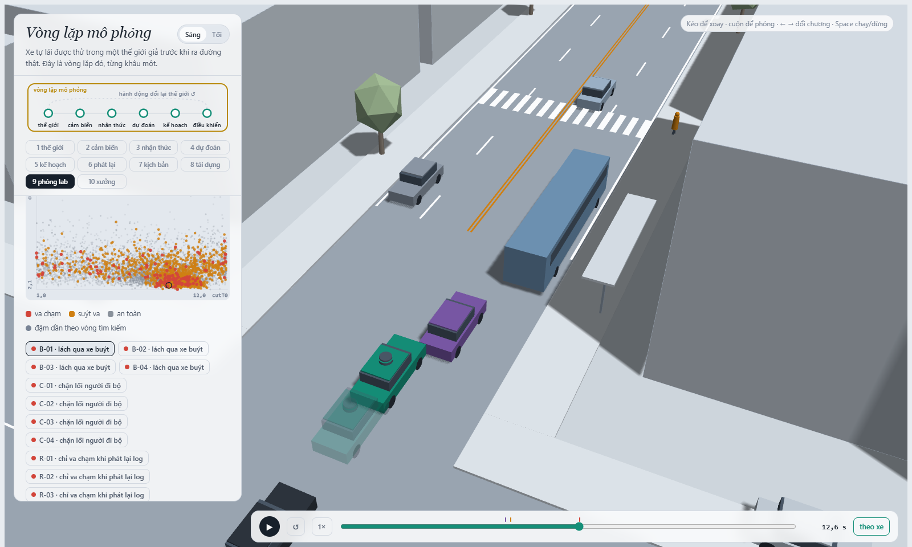
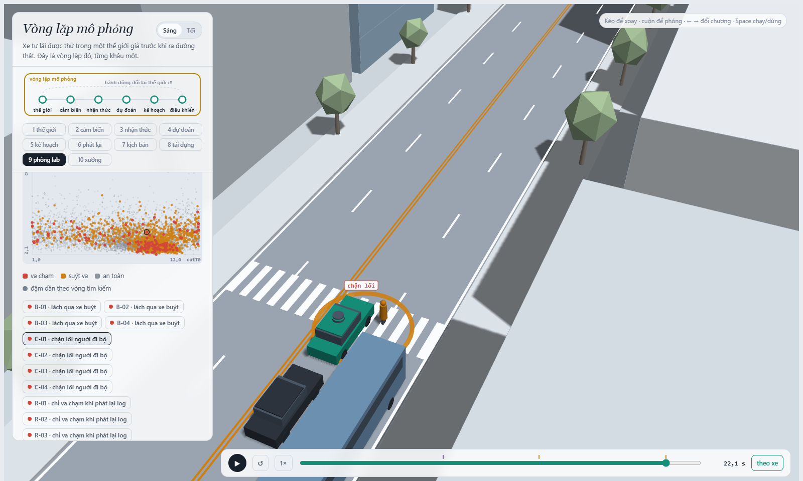
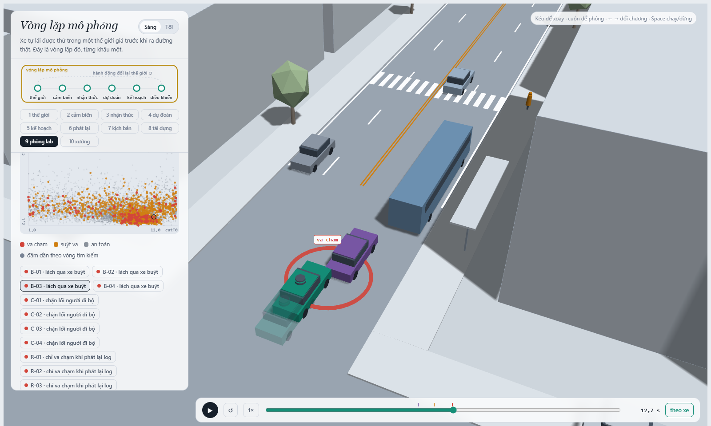
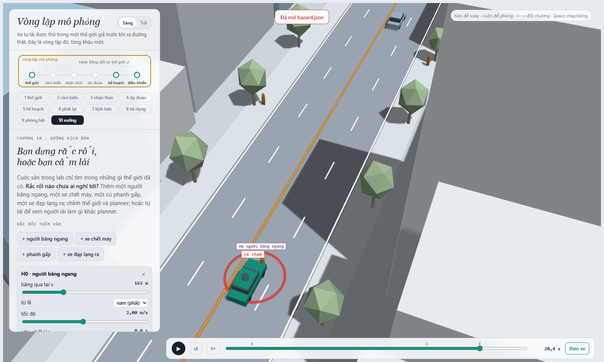
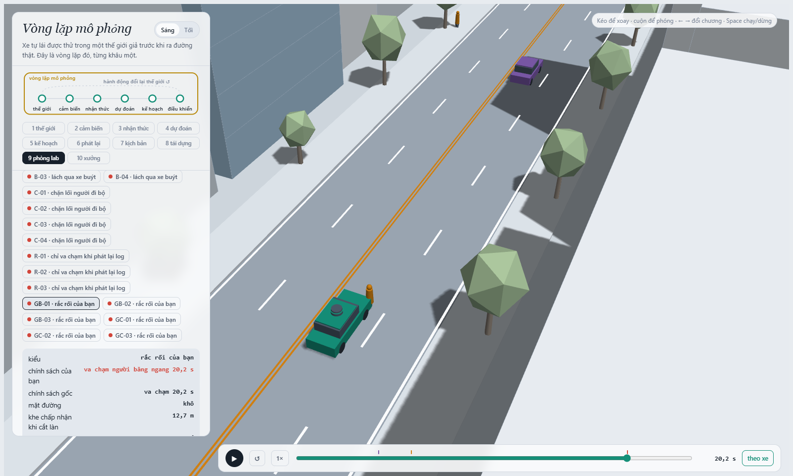

MSSV: 2A202602563

# Lab 11 · Scenario Forge — báo cáo

Hoàng Quốc Việt · MSSV 2A202602563. Toàn bộ `evidence/` sinh bằng `python run_all.py all` bản đầy đủ (không `--quick`), rồi `python run_all.py mine hazard.json` và `python run_all.py export`, với `LAB11_MSSV=2A202602563` (đúng MSSV trong danh sách lớp; `meta.json: _run.quick = false`). Số nào lấy từ lần chạy thêm **ngoài** `evidence/` đều ghi rõ "chạy thêm".

Thị trấn của bạn (`meta.json: _run.town`): **A** (seed: `meta.json: seeds` = mc 4000515319, search 114397369, test 4059766521).

## 1. Phát lại log có trung thực không? (bước A)

| `replay.json` | giá trị |
|---|---|
| `n` / `n_used` | 400 / 399 |
| `dropped_human_crash_logs` (người lái tự gây va chạm, bỏ) | 1 |
| planner trên log phát lại: `replay.crashes` | **110** (`rear` 97, `side` 13, `front` 0) |
| planner trong thế giới phản ứng: `reactive.crashes` | **0** |
| `crash_in_both` | 0 |

Gần như mọi va chạm của "phát lại" là `rear`: xe bám đuôi TG chạy đúng quỹ đạo đã ghi khi **người** lái xe ta (IDM người: `T` 1,1 s, `b` 3,5). Planner thận trọng hơn (`T` 1,6 s, giảm còn `cautionV` 7,5 m/s gần vạch bị xe buýt che) nên phanh **sớm hơn** người lái; log không biết điều đó nên TG trong log không phanh theo và tông vào đuôi. Đó là va chạm **giả**: trong thế giới phản ứng, TG thấy xe ta chậm lại và phanh, nên cả 399 kịch bản đều 0 va chạm và `crash_in_both` = 0.

Ví dụ `replay_only[0]` (kịch bản 4, `contact = rear`, ảnh `evidence/shots/q1_replay_only.png`): TG bám rất sát (`tgT` = 0,70 s). Xe ta giảm tốc trước vạch bị che, TG phát lại vẫn giữ tốc độ của log, va chạm đuôi lúc 16,2 s (trình xem hiện thêm hai va chạm nối tiếp 19,1 s và 23,7 s). Trong thế giới phản ứng, TTC nhỏ nhất chỉ là `min_ttc_reactive` = 3,15 s, không va chạm.

## 2. Kịch bản bất khả thi (bước B)

Luật trong `lab11/feasible.py: is_feasible` (loại nếu vi phạm **bất kỳ** luật nào):

| Luật | Căn cứ vật lý |
|---|---|
| chuyển làn cosine 3,5 m trong `cutDur` s có a_lat đỉnh = (π/cutDur)²·3,5/2; loại nếu a_lat > μg | Lực ngang lốp không vượt μ·m·g (vòng ma sát); quá thì xe trượt chứ không chuyển làn được |
| `cutBrake` > μg | Phanh dọc cũng bị giới hạn bởi ma sát; khô μ 0,8 → 7,85 m/s², ướt μ 0,5 → 4,9 m/s² |
| `pedV` > 2,5 m/s | Đó là chạy, không phải đi bộ: tốc độ đi bộ tối đa của nam 20–29 tuổi khoảng 2,53 m/s (Bohannon 1997) |
| `cutV` ∉ (0, 22] m/s | Xe đứng yên không "cắt làn"; trên 22 m/s (≈ 79 km/h) là ngoài dải tốc độ phố này |

Số kịch bản bất khả thi bị bỏ (`hunt.json: infeasible`): bus_bypass 4, cut_in 5, **crosswalk_block 8** (nhiều nhất), rear_ended 0; Monte Carlo tự nhiên chỉ 10/3 000 (`mc.json: infeasible`). Cuộc săn `crosswalk_block` kéo `p_bin` của đường ướt lên 0,97 (`hunt.json: crosswalk_block.proposal.p_bin[0]`) vì μ = 0,5 làm quãng phanh dài ra, tức "nguy hiểm" hơn theo điểm của nó. Nhưng cũng chính μ = 0,5 làm ngân sách ma sát hẹp lại: cùng một cú chuyển làn hay phanh sau khi vào làn, đường khô thì làm được, đường ướt thì vượt μg. CEM chỉ thấy điểm nguy hiểm nên bị kéo về phía mép vật lý; vùng nguy hiểm nhất luôn nằm sát (và vượt qua) giới hạn khả thi. Nếu **đếm** chúng là va chạm, ước lượng bị thổi phồng bằng những tai nạn không đường thật nào tạo ra được, và phần thổi phồng lớn nhất đúng ở kiểu mà cuộc săn đẩy về mép đó.

## 3. Monte Carlo cho bạn biết gì (bước C1)

`mc.json`: k = `crashes` = **2**, n = **3 000**, p̂ = `p` = **6,67·10⁻⁴**, Wilson 95 % = [`lo` 1,83·10⁻⁴, `hi` 2,43·10⁻³]. Cả 2 vụ là `bus_bypass` (`mc.json: modes`).

Muốn khoảng hẹp còn ±20 % của p: 1,96·√(p/n) ≤ 0,2p ⇒ n ≈ 96/p = 96 / 6,67·10⁻⁴ ≈ **144 000 lần chạy**, gấp 48 lần ngân sách 3 000.

Kiểu **chưa xuất hiện** trong 3 000 lần chạy: `cut_in`, `crosswalk_block`, `rear_ended`, `other` (k = 0 cả bốn). Con số đúng để báo **không phải 0** mà là cận trên Wilson: P < **1,28·10⁻³** cho mỗi kiểu (`mc.json: per_mode.<kiểu>.hi` = 0,0012789). Ở mục 4, IS đo được `crosswalk_block` cỡ 5·10⁻⁷, nằm dưới cận này đúng như phải thế; còn `cut_in` và `rear_ended` vẫn chưa thấy ở cả IS nên chỉ có cận trên.

## 4. Importance sampling, ESS và độ suy biến (bước C3)

Mỗi seed: n = 600 mẫu từ hỗn hợp phòng thủ q = 0,8·CEM + 0,2·tự nhiên (`estimate.json: seeds[i].per`).

| kiểu | seed | `p` | `hits` | `ess` | `top_share` |
|---|---|---|---|---|---|
| bus_bypass | 0 | 4,27·10⁻³ | 25 | 123,6 | **0,69** |
| bus_bypass | 1 | 5,08·10⁻⁴ | 19 | 114,6 | 0,17 |
| bus_bypass | 2 | 8,68·10⁻⁴ | 34 | 145,8 | **0,54** |
| crosswalk_block | 0 | 4,37·10⁻⁷ | 96 | 127,0 | 0,29 |
| crosswalk_block | 1 | 6,93·10⁻⁷ | 94 | 131,6 | 0,27 |
| crosswalk_block | 2 | 5,28·10⁻⁷ | 96 | 112,1 | 0,41 |
| cut_in | 0 / 1 / 2 | chưa thấy: **< 0,025** (`upper_zero_hits`) | 0 | 119,4 / 129,0 / 121,7 | 0 |
| rear_ended | 0 / 1 / 2 | chưa thấy: **< 0,025** (`upper_zero_hits`) | 0 | 119,0 / 120,2 / 112,1 | 0 |

`total` theo seed: 4,27·10⁻³, 5,09·10⁻⁴, 8,69·10⁻⁴; **trung vị 8,69·10⁻⁴**. `other` = 0 với cận trên 1,28·10⁻³, lấy từ `mc.json` (`estimate.json: other.source`).

- **Các seed có đồng ý?** `crosswalk_block` có: 4,4–6,9·10⁻⁷, chênh 1,6 lần. `bus_bypass` thì không: chênh 8,4 lần (5,1·10⁻⁴ đến 4,3·10⁻³). Monte Carlo (6,67·10⁻⁴, Wilson [1,8·10⁻⁴; 2,4·10⁻³]) khớp seed 1 và 2. Seed 0 nằm sát cận trên Wilson, và đó chính là seed có `top_share` cao nhất.
- **`top_share` > 0,5:** bus_bypass seed 0 (0,69) và seed 2 (0,54). Khi đó một mẫu duy nhất có trọng số w = p/q rất lớn (một kịch bản nằm ở đuôi q của CEM nhưng vẫn có mật độ tự nhiên đáng kể) mang 69 % cả ước lượng. Con số thực ra là "trọng số của một mẫu ÷ 600": rút lại thì mẫu đó có thể không xuất hiện và p rơi xuống cỡ seed 1. Khoảng ±1,96·se của seed 0 ([0; 1,02·10⁻²]) rộng chính vì thế, nhưng ngay cả se cũng bị ước lượng từ chính các mẫu nặng đó nên không đáng tin. Ngược lại, `top_share` thấp (seed 1, 0,17) **không** chứng minh ước lượng đúng: nếu q bỏ sót hẳn một vùng va chạm thì chẳng có mẫu nặng nào để báo động (README, bẫy 3).
- **Ngân sách:** `estimate.json: budget` = **16 800** lần chạy (săn + 3 seed × 600 mẫu, cho mọi kiểu). Để Monte Carlo đạt cùng sai số tương đối như IS seed 1 cho `bus_bypass` (se/p = 1,69·10⁻⁴ / 5,08·10⁻⁴ ≈ 0,33) cần n ≈ 1/(p·0,33²) ≈ 1,8·10⁴ lần, cùng cỡ ngân sách. Với `crosswalk_block` (p ≈ 5·10⁻⁷, se/p ≈ 0,35) cần n ≈ 1/(5·10⁻⁷·0,35²) ≈ **1,6·10⁷** lần, gấp khoảng 1 000 lần ngân sách IS. IS thắng áp đảo đúng ở kiểu hiếm nhất.
- **`other`** không có hàm điểm nguy hiểm riêng (không biết "gần va chạm kiểu khác" nghĩa là gì) nên không săn được; phần của nó lấy từ Monte Carlo tự nhiên (`mc.json: per_mode.other`: k = 0 trên 3 000, cận trên 1,28·10⁻³). Tổng = các kiểu + `other`.

## 5. Các kiểu thất bại (bước C2 + 3D)

`hunt.json: <cuộc săn>.found`:

| cuộc săn | tìm thấy |
|---|---|
| bus_bypass | bus_bypass 121 |
| cut_in | bus_bypass 20 (không có cut_in nào) |
| crosswalk_block | crosswalk_block 75, bus_bypass 1 |
| rear_ended | crosswalk_block 10, bus_bypass 2 (không có rear_ended nào) |

**Lách qua xe buýt** (`bus_bypass`, ảnh `evidence/shots/q5_bus_bypass_B01.png`, va chạm 12,6 s, đường ướt μ 0,5): xe buýt đỗ chiếm làn ngoài E2, xe C2 ở E2 phải lách sang làn xe ta để vượt. C2 chấp nhận một khe rất ngắn (`cutGap` 4,0 m) và chậm lại (< 6 m/s) khi đang lấn. Planner chỉ coi C2 là xe phía trước khi C2 vào hẳn hành lang `cutinLat` = 2,15 m, nên phản ứng muộn và đâm vào hông/đuôi C2 ở x < 112 m.

**Chặn lối người đi bộ** (`crosswalk_block`, ảnh `evidence/shots/q5_crosswalk_block.png`, 22,1 s, đường ướt, người đi bộ **không** ngó qua xe buýt): người đi bộ bước ra từ sau xe buýt; cảm biến xe ta bị thân xe buýt che nên không thấy, không kích hoạt dự đoán nhường đường. Khi người đi bộ ló ra, quãng phanh trên đường ướt quá dài, xe dừng nhưng thân xe đã nằm trên vạch, người phải đứng lại (sự kiện `kind == "block"`).

**Không tìm thấy:** `cut_in` và `rear_ended`. Cả hai đều 0 trong 3 000 Monte Carlo và 0 hits trong 3×600 mẫu IS. Mức tin: chỉ biết chúng **< 0,025** (IS, `upper_zero_hits`) và **< 1,28·10⁻³** (Wilson MC), tức hiếm hơn lách xe buýt nhiều khả năng, nhưng không thể nói "không xảy ra". Hành lang 2,15 m và `T` 1,6 s khiến cắt làn ở chỗ thoáng và bị tông đuôi đều khó, nhưng điểm nguy hiểm của các cuộc săn đó (TTC tới C2, TTC của TG) bị kéo sang vùng lách xe buýt / chặn lối dễ va hơn.

**Vì sao săn riêng từng kiểu:** chính bảng trên. Cuộc săn `cut_in` co về `bus_bypass` (20 va chạm, 0 cut_in) vì TTC tới C2 thấp nhất khi C2 lách xe buýt; cuộc săn `rear_ended` co về `crosswalk_block`/`bus_bypass` (xe ta phanh gấp vì người đi bộ là lúc TG dễ áp sát nhất). Một cuộc săn chung sẽ chỉ báo `bus_bypass` và `crosswalk_block`, rồi tưởng nhầm hai kiểu đó là toàn bộ rủi ro.

## 6. Sửa planner (bước E + 3D)

`fix.json`: TRAIN (`table`, n = 400 mẫu rút nơi policy gốc thất bại) chỉ dùng để chọn; TEST (`chosen_test`, `baseline_test`) dùng seed mới và một cuộc săn mới nhắm vào chính policy đó.

| | `fail` | `fail_hi_seen` | `fail_hi` | `unseen` | `progress` (m) | `harsh` (khung phanh > 3 m/s²) |
|---|---|---|---|---|---|---|
| policy gốc, TRAIN (`baseline_train`) | 1,03·10⁻³ | 2,34·10⁻³ | 2,34·10⁻³ | – | 214,0 | 8,84 |
| **chọn `{cutinLat: 2.6}`**, TRAIN (`chosen`) | 5,72·10⁻⁷ | 9,73·10⁻⁷ | 9,73·10⁻⁷ | bus_bypass | 214,1 | 7,70 |
| **chọn `{cutinLat: 2.6}`**, **TEST** (`chosen_test`) | **4,44·10⁻⁷** | **7,16·10⁻⁷** | **3,88·10⁻²** | bus_bypass | 214,5 | 8,22 |
| policy gốc, **TEST** (`baseline_test`) | **1,18·10⁻³** | 2,15·10⁻³ | **3,43·10⁻³** | – | 214,7 | 8,09 |

`choose_policy` chọn `cutinLat` 2,6: ba ứng viên `cutinLat` 2,6 / 3,0 / 3,3 hoà `fail_hi` 9,73·10⁻⁷, và 2,6 có quãng đường dài nhất (214,08 m). `{cutinLat 3.0, cautionV 6.5}` có `fail_hi` thấp hơn (6,18·10⁻⁷) nhưng chỉ đi 198,1 m, dưới ngưỡng 95 % × 214,0 = 203,3 m, nên bị loại. Cơ chế: hành lang 2,6 m làm xe ta nhận C2 đang lách xe buýt là "xe phía trước" sớm hơn khoảng nửa mét lệch ngang, phanh theo nó thay vì đâm vào hông; quãng đường gần như không mất (214,5 so với 214,7 m).

**Vì sao `fail_hi` của bản sửa (3,88·10⁻²) lại lớn hơn `fail` của policy gốc (1,18·10⁻³) dù bản sửa tốt hơn thật:** trên TEST, bản sửa không còn va chạm `bus_bypass` nào, nên cận trên hợp lệ của kiểu đã "biến mất" đó là `upper_zero_hits` = 3/(0,2·400) = 0,0375, cộng thêm cận các va chạm khác trên 3 000 lần tự nhiên (1,28·10⁻³). 400 mẫu không thể chứng nhận một kiểu dưới khoảng 10⁻²; muốn chứng nhận p < 10⁻³ cần cỡ 15 000 lần chạy đúng chỗ đó. Con số dữ liệu cho thấy là `fail_hi_seen` = 7,16·10⁻⁷, còn 3,88·10⁻² là điều dữ liệu **được phép nói chắc**.

Ảnh có bóng mờ (`evidence/shots/q6_fix_ghost_bus_bypass.png`, run B-03, đường khô, `cutGap` 7,1 m): xe ta đặc là policy gốc (cuộc săn tìm ra va chạm dưới policy gốc) đâm C2 lúc 12,7 s; **bóng mờ** là xe ta với policy đã chọn trên cùng kịch bản, lùi lại phía sau và không va chạm. Ở chương 9, với run đã ghim policy gốc, trình xem vẽ bản sửa làm bóng mờ.

**Núm "nghe thì an toàn hơn" nhưng làm tăng thất bại: `T` = 2,0 s** (giữ khoảng cách xa hơn). Trên TRAIN, `fail` = 1,38·10⁻³ (`fail_hi` 2,74·10⁻³), **tệ hơn** policy gốc (1,03·10⁻³ / 2,34·10⁻³). `crosswalk_block` tăng 3,5 lần (1,98·10⁻⁶ so với 5,72·10⁻⁷) và `bus_bypass` cũng tăng (1,38·10⁻³ so với 1,03·10⁻³). Thế giới phản ứng lại: khe trống lớn hơn trước xe ta lọt vào khe chấp nhận `cutGap` của C2 thường xuyên hơn, nên C2 chen vào ngay trước mũi xe ta, đúng đoạn có xe buýt. Xe ta cũng tới vạch muộn hơn, lệch nhịp với lúc xe buýt rời bến và người đi bộ bước xuống. Tương tự, thêm `pedBuffer` 3,5 vào `cutinLat` 2,6 (+ `cautionV` 7) làm `bus_bypass` xuất hiện trở lại (1 hit, 8,5·10⁻⁶, so với 0 khi chỉ có `cutinLat` 2,6). Ở phía ngược lại, `cautionV` 5,0 gần như hết va chạm nhưng chỉ đi 171,5 m (−20 %), không còn là planner chở người được.

## 7. Từ mô phỏng ra đường thật

| Giả định trong `space.py` (thị trấn A) | Dữ liệu thật thay nó, lấy từ đâu | Nếu sai thì con số sai theo hướng nào |
|---|---|---|
| **Khe chấp nhận khi cắt làn** `cutGap` ~ log-chuẩn, trung vị 12 m, σ 0,35 | Khe chấp nhận đo từ quỹ đạo thật: highD (Krajewski et al. 2018, IEEE ITSC, 5 600 lần chuyển làn trọn vẹn) / NGSIM; với phố Việt Nam cần quay video từ trên cao tại điểm dừng xe buýt (nhiều xe máy) | Người lái thật (nhất là xe máy) chấp nhận khe ngắn hơn ⇒ `bus_bypass` và `cut_in` của tôi đang **bị ước lượng thấp**; đây là kiểu chiếm gần hết tổng |
| **Người đi bộ ngó qua xe buýt** `pedLook` p = 0,85 | Quan sát hành vi tại bến xe buýt có vạch qua đường: dữ liệu inD (Bock et al., arXiv:1911.07602, > 11 500 người tham gia giao thông) hoặc tự quay ở Hà Nội; Truong et al. 2022 (Safety Science 153) đo 14,4 % người qua đường ở Hà Nội bị phân tâm | Nếu ít người ngó hơn (phân tâm, vội) ⇒ `crosswalk_block` **bị ước lượng thấp**; hunt đã cho thấy kiểu này sống ở vùng `pedLook` = 0 |
| **Mặt đường ướt** 20 % số chuyến, μ ướt = 0,5 / khô = 0,8 | Tần suất ngày mưa từ số liệu khí tượng địa phương (mùa mưa Hà Nội/TP HCM mưa nhiều ngày hơn 20 %); hệ số ma sát đo bằng thiết bị đo ma sát mặt đường (FHWA-HRT-14-065: một lớp nước 0,002 in làm giảm 20–30 % so với khô; bảng μ khô/ướt của Wong, *Theory of Ground Vehicles* tôi chưa kiểm tra được ở bản gốc) | Mưa nhiều hơn hoặc μ ướt thấp hơn 0,5 ⇒ quãng phanh dài hơn ⇒ cả `crosswalk_block` lẫn `bus_bypass` **bị ước lượng thấp**; đồng thời nhiều cú chuyển làn bị luật khả thi loại hơn |

## 8. Giới hạn

1. **Một con phố, một bến xe buýt, một vạch qua đường, 24 s.** Xác suất tôi báo là "mỗi lần đi qua đúng đoạn này trong 24 s", không phải mỗi km hay mỗi chuyến thật; giao lộ, rẽ trái, đèn tín hiệu, làn xe máy đều không có.
2. **Người lái khác chỉ là IDM "lịch sự" (`civil = true`) và không có xe máy.** Không ai vượt đèn, lấn vạch hay lạng lách, trong khi ở Việt Nam đó chính là nguồn rủi ro lớn. Phản ứng của thế giới (ví dụ C2 chen vào khe `T` 2,0 s) chỉ đúng như mô hình gap acceptance đơn giản cho phép.
3. **Cảm biến hoàn hảo, trừ phần bị xe buýt che; và "tránh được" chỉ thử phanh.** Không có nhiễu, trễ nhận thức, nhận nhầm, mưa làm giảm tầm nhìn; xe ta không bao giờ đánh lái né. Mọi con số xác suất cũng dựa trên phân phối tự nhiên giả định (mục 7), nên chúng có điều kiện trên thị trấn dạy học này.

Thêm một tuần: (a) khớp `cutGap`, `pedLook`, tỉ lệ ngày ướt từ highD/inD và video bến xe buýt Hà Nội, chạy lại toàn bộ để xem tổng dịch chuyển bao nhiêu; (b) chạy ~15 000 lần TEST trên vùng `bus_bypass` để thật sự chứng nhận bản sửa < 10⁻³; (c) săn thêm với hàm điểm khác cho `cut_in` / `rear_ended` để xem chúng thật sự hiếm hay chỉ bị CEM bỏ sót.

## 9. Rắc rối của bạn (bước G + chương 10)

- **Rắc rối:** một **người băng ngang giữa đoạn phố** (không có vạch), bước ra từ lề nam (bên phải xe ta), ở x 140–300 m, tức sau bến xe buýt và vạch qua đường x = 122. Họ bắt đầu bước khi xe ta còn cách 15–45 m, đi 1,0–2,5 m/s. Ngoài đời đây là người vội qua đường giữa đoạn để đón xe/qua quán bên kia, tình huống chiếm 74–75 % số người đi bộ tử vong ở Mỹ (ngoài giao lộ, NHTSA DOT HS 813 590 / 813 727). Cảnh cụ thể trong `hazard.json` (x 162,5 m, 2,0 m/s, trigger 37,5 m, đường khô): planner va chạm `('ego', 'H0', 20.35)` (`mine.json: exact.planner`), và trình xem JS cho đúng 20,4 s.
- **Căn cứ vì sao planner sẽ xử lý kém:** đọc `avsim/core.py`, phần dự đoán người đi bộ của planner (`t_enter` so với `t_arrive + pedBuffer`, nhường từ xa) **chỉ áp dụng cho P1 trên vạch WALK**. Một người băng ngang ngoài vạch chỉ được coi là "vật cản phía trước" khi đã đứng trong hành lang ±1,9 m của xe ta, và khi đó xe ta phanh bằng IDM (phanh "thoải mái" `b` = 2 m/s²), không phải phanh khẩn cấp. `pedBuffer`, `cautionV`, `cautionRange` đều gắn với vạch qua đường nên không núm nào chạm tới tình huống này.
- **Giả định** (`hazard.json: why`):
  - `space.h0_x` [140, 300]: cả đoạn phố không vạch.
  - `space.h0_v` [1,0; 2,5]: cận dưới ≈ phân vị 15 của người ≥ 65 tuổi, 0,97 m/s (Knoblauch et al. 1996, TRR 1538); cận trên = tốc độ đi bộ tối đa của nam trẻ, 2,53 m/s (Bohannon 1997), trùng luật khả thi `pedV` ≤ 2,5.
  - `space.h0_trig` [15, 45] m: khe thời gian người qua đường giữa đoạn chấp nhận có trung vị 2,75 s và phân vị 85 là 3,65 s (Khaki & Mohammadnazar 2021, arXiv:2101.10903); nhân với khoảng 12 m/s ra 1,25–3,75 s ≈ 15–45 m.
  - `exposure` = **0,07** mỗi chuyến = 1 lượt người qua đường mỗi chuyến trên đoạn phố này (cùng giả định của thị trấn) × 13,89 % lượt qua đường là giữa đoạn không vạch (Balk et al. 2014, FHWA-HRT-13-098; dao động 3–37 %) × ½ đi từ lề nam. Đây là ước lượng theo nguồn Mỹ, chưa có số đo ở Hà Nội/TP HCM.
- **Kết quả** (`mine.json`, `accepted` = **0,995**: 1 493/1 500 phiên bản khả thi, 7 bị loại):

| `mine.json` | policy gốc (`baseline`) | policy đã chọn `{cutinLat 2.6}` (`chosen`) |
|---|---|---|
| `crashes` | 39 | 35 |
| `avoidable` (tránh được bằng phanh hết cỡ ngay khi thấy) | **35** | **35** |
| `unavoidable` | 0 | 0 |
| `unattributed` (va chạm thường của thị trấn) | 4 | 0 |
| `low_speed` (< 1 m/s) | 2 | 2 |
| `avoidable_foreknown` | 35 | 35 |
| P(lỗi planner \| rắc rối) = `p` [Wilson `lo`, `hi`] | **2,34·10⁻²** [1,69·10⁻²; 3,24·10⁻²] | **2,34·10⁻²** [1,69·10⁻²; 3,24·10⁻²] |
| tần suất mỗi chuyến `per_trip` (cận trên `per_trip_hi`) | **1,64·10⁻³** (2,27·10⁻³) | **1,64·10⁻³** (2,27·10⁻³) |

  Đặt cạnh lách xe buýt của thị trấn: `bus_bypass` ≈ 6,7·10⁻⁴ (Monte Carlo, `mc.json`) đến 8,7·10⁻⁴ (trung vị IS, `estimate.json`) mỗi chuyến. **Rắc rối của tôi ≈ 2 lần lách xe buýt**, và đó toàn là lỗi tránh được.

  Bản sửa ở bước E **không cứu được một vụ nào**: 35 vụ `avoidable` vẫn còn nguyên. Bốn vụ `unattributed` biến mất là bốn vụ lách xe buýt thường (ví dụ C2 lúc 12,5 s, khi người băng ngang chưa bước ra), đúng kiểu mà `cutinLat` 2,6 đã sửa. Đây là ví dụ "rắc rối hay" theo README: tránh được, planner vẫn dính, bản sửa không chạm tới. `avoidable_foreknown` = `avoidable` = 35: người băng ngang từ lề nam sau xe buýt **không bị che**, cảm biến thấy ngay lúc họ bước (trong `examples`, `brake_t` = `fire_t`, khoảng 3–4 s trước va chạm), nên lỗi nằm ở **logic quyết định**, không ở tầm nhìn.

- **Phân biệt ba loại:** `avoidable` = cùng planner, nhưng từ khung hình đầu tiên rắc rối đã bắt đầu **và** cảm biến thấy nó thì phanh hết cỡ (μg), và không va chạm: đây là lỗi planner. `unavoidable` = phanh hết cỡ ngay lúc đó vẫn va chạm (ở đây 0: với trigger ≥ 15 m, quãng phanh luôn đủ). `unattributed` = va chạm xảy ra khi rắc rối chưa hành động, không nói gì về rắc rối.
- **Vì sao "tránh được" là chuẩn lạc quan, theo hai hướng:**
  - **Đếm nhiều hơn:** người phanh-oracle **biết ngay** đây là rắc rối và phanh tối đa từ khung đầu tiên nhìn thấy, không có trễ nhận thức, phân loại hay do dự, cũng không lo bị xe sau tông. Một planner thật không làm được điều đó, nên `avoidable` là **cận trên** của số vụ mà một planner hợp lý lẽ ra tránh được.
  - **Đếm ít đi:** oracle chỉ thử **phanh**, không thử **đánh lái** né sang làn trống. Một số vụ tính là `unavoidable` (ở đây là 0) có thể tránh được bằng cách lách.
- **Hình:** `evidence/shots/q9_studio_jaywalker.png` (chương 10, đúng cảnh trong `hazard.json`, va chạm 20,4 s) và `evidence/shots/q9_mine_baseline.png` (chương 9, run GB-01 từ `mine.json`, va chạm 20,2 s; bóng mờ policy đã chọn cũng va chạm).

- **Bạn tự lái thì sao:** tôi không ghi một lượt tự lái (`hazard.json: ego = "planner"`, không có `egoAcc`). Phép thử thay thế là oracle của `mine`: phanh hết cỡ ngay khi người băng ngang bước xuống thì tránh được cả 35/35 vụ. Người lái để ý lề đường sẽ nhả ga khi thấy người đứng mép đường nhìn sang, điều planner không làm.
- **Cách sửa:** không núm nào sửa được. Tôi chạy thêm, **ngoài `evidence/`**, đúng 1 493 phiên bản của `mine` với từng núm (script dùng lại `run_all.mine_policy`):

  | policy (chạy thêm) | `avoidable` | P(lỗi planner \| rắc rối) |
  |---|---|---|
  | `cutinLat` 2,6 (bản sửa, có trong `mine.json`) | 35 | 2,34·10⁻² |
  | `pedBuffer` 3,5 | 35 | 2,34·10⁻² (không đổi: núm này chỉ áp dụng cho P1 trên vạch) |
  | `b` 3,0 (phanh thoải mái mạnh hơn) | 34 | 2,28·10⁻² |
  | `v0` 11,0 (giảm tốc độ mong muốn từ 12,5) | 21 | 1,41·10⁻² [9,2·10⁻³; 2,1·10⁻²] |

  Chỉ hạ tốc độ là có tác dụng (va chạm chậm hơn, phanh kịp hơn), nhưng vẫn còn 21 vụ và phải trả giá quãng đường trên **mọi** chuyến (tốc độ tối đa giảm 12 %, nhiều khả năng vượt mức mất 5 % mà `choose_policy` cho phép), để chữa một rắc rối xảy ra 7 % số chuyến. Planner cần thêm logic.

  Logic mới cần thêm (mô tả, không code):
  1. Mở rộng dự đoán băng ngang (`t_enter` so với `t_arrive + pedBuffer`) từ riêng P1 trên vạch sang **mọi người đi bộ được theo dõi** có vận tốc hướng vào làn xe ta, ở bất kỳ x nào.
  2. Thêm **phanh khẩn cấp (AEB)**: khi TTC tới một vật trong đường đi dự đoán < khoảng 2 s, phanh tới μg thay vì IDM `b` = 2 m/s².
  3. Giảm tốc thận trọng khi có người đứng ở mép lề trong phạm vi khoảng 40 m, không chỉ gần vạch bị che.
